# Candle Harness

A trading terminal for [Candle](https://candle.tv) that runs in your terminal, with your own AI agent working beside you.

<picture>
  <source media="(prefers-color-scheme: dark)" srcset=".github/readme/demo-dark.svg">
  <source media="(prefers-color-scheme: light)" srcset=".github/readme/demo-light.svg">
  
</picture>

The agent reads Candle and its market data for you: the feed, the signal tape, wallets worth watching, token checks, your positions and P&L. It proposes trades, and each one comes to you as a card you approve with one key press. It runs on a coding agent you already use and are signed in to (Claude Code, Codex, Grok, OpenCode or Pi), so the Candle Harness ships no model sign-in of its own.

## Install

On macOS 13 or later, or Linux (on Windows, use WSL 2):

```sh
curl -fsSL https://github.com/candledottv/harness/releases/latest/download/install.sh | bash
```

Then run `candle-harness`. The first run walks you through setup and starts you on paper: about five minutes with your AI coding tool (Claude Code, Codex, Grok, OpenCode or Pi, with its own account) already signed in, longer if you install one first. The installer checks each file's checksum and signature before it installs anything, and offers to install Candle's CLI if you have none. [Installing](https://docs.candle.tv/harness/install) says what it checks.

To have your own agent install it, point it at [Installing it with an agent](https://docs.candle.tv/harness/install#installing-it-with-an-agent): it says what the agent runs, what it asks you, and what it never does. Setup stays yours.

## How it works

- **One small process on your machine, the core, holds your agents' keys and trades.** Every screen and every agent attaches to it, and nothing else holds a key.
- **The agent proposes; you approve.** Every trade the agent proposes is a card, priced fresh and checked against your limits. `⏎` approves it. You can also let a wallet trade small amounts inside two figures of its own, with no card.
- **Paper first.** Trades on paper are recorded at the quoted price and never sent. Go live when you're ready.
- **The kill switch** (`ctrl-x` twice) stops the agent and pauses buys at once.
- **The agent acts when you message it.** For anything later (a stop, a buy every morning, a signal to watch for), it sets up a trigger with you, which the core runs itself, with the Candle Harness's window open or closed. For a strategy that keeps buying on Hacc's signals and selling by its own exits, it sets up a rules bot. Pro and Max.
- **Build your own bots.** The Build tab runs your own coding harness in a folder of your bots. It writes a code bot, tests it on paper and proposes it; your press starts it. The core runs it, with a token of its own and never a key, and holds every trade it makes to the figures you approved. Pro and Max.

## Which wallet pays

A trade pays from a wallet on its own chain. A wallet you name with `from` is refused before any card is made if it's on the other chain, with `WRONG_CHAIN` and words naming both chains. This includes naming the embedded wallet's Solana address for a Hood token (a `0x` address), or its Hood address for a Solana token. `from embedded` takes the embedded wallet on the trade's chain.

A default in `config.toml` that resolves to either embedded address takes the embedded wallet on the trade's chain, whether set as `embedded`, a name for it, or either of its addresses. This also holds when the default is pinned to either embedded address. A TEE default on the other chain is refused before any card is made, with `DEFAULT_WALLET_NOT_PAYABLE` and words naming both chains. On paper, either embedded address is the embedded wallet.

## The guide

The user guide is on Candle's docs site, at [docs.candle.tv/harness](https://docs.candle.tv/harness):

- [Getting started](https://docs.candle.tv/harness/getting-started): install, setup, a paper trade, going live
- [The screen](https://docs.candle.tv/harness/the-screen), [your agent](https://docs.candle.tv/harness/your-agent), [trading](https://docs.candle.tv/harness/trading), [wallets](https://docs.candle.tv/harness/wallets), [limits](https://docs.candle.tv/harness/limits) and [safety](https://docs.candle.tv/harness/safety)
- [Triggers](https://docs.candle.tv/harness/triggers): when something happens, do something; [rules bots](https://docs.candle.tv/harness/bots): a Hacc strategy the core runs for you; [code bots](https://docs.candle.tv/harness/code-bots) and [the Build tab](https://docs.candle.tv/harness/build): your own, built with your own coding harness; and [running on a VPS](https://docs.candle.tv/harness/vps)
- [Engines](https://docs.candle.tv/harness/engines): where Claude Code, Codex, Grok, OpenCode and Pi differ
- [Troubleshooting](https://docs.candle.tv/harness/troubleshooting): `candle-harness doctor`, and the common snags
- The reference: [keys](https://docs.candle.tv/harness/reference/keys), [typed commands](https://docs.candle.tv/harness/reference/typed-commands), [settings](https://docs.candle.tv/harness/reference/config) and [Candle's commands](https://docs.candle.tv/harness/reference/cli-parity)
- For developers: [architecture](https://docs.candle.tv/harness/developers/architecture), [the attach protocol](https://docs.candle.tv/harness/developers/attach-protocol) and [the bot protocol](https://docs.candle.tv/harness/developers/bot-protocol)

## Trading carries risk

Nothing the Candle Harness or its agent shows is financial advice. Signals, backtests and replays describe the past, and the agent can be wrong. Read Candle's [Risk Disclosure Statement](https://docs.candle.tv/core-terms/risk-disclosure).

## Contributing and security

Issues are welcome. [CONTRIBUTING.md](CONTRIBUTING.md) covers building, testing and how changes are made. Report a security issue to `security@candle.tv`, not in an issue: [SECURITY.md](SECURITY.md) says what's in scope. What changed in each version is in [CHANGELOG.md](CHANGELOG.md).

## License

MIT ([LICENSE](LICENSE)). The Quant preset carries ten of Candle's own skills, and the bots folder nine of its bot-building skills, each copied unchanged under Candle's MIT licence ([`skills/LICENSE`](skills/LICENSE), [`skills/SOURCE`](skills/SOURCE), [`build-skills/LICENSE`](build-skills/LICENSE), [`build-skills/SOURCE`](build-skills/SOURCE)).
